# REPORT_IT: Campus Lost and Found Management System
## Microproject Report for User Interface Design Lab & Relational Database Management Systems (RDBMS) Lab

---

**Course Titles:**  
1. User Interface Design Laboratory  
2. Relational Database Management Systems (RDBMS) Laboratory  

**Academic Year:** 2025 – 2026  
**Semester:** IV / VI Semester B.Tech  
**Department:** Department of Computer Science and Engineering  
**Institution:** Amal Jyothi College of Engineering  

**Submitted By:**  
- **Student Name:** Adarsh  
- **Register Number / Student ID:** AJCE001  

**Faculty Guides / Laboratory In-Charges:**  
- **UI Design Lab In-Charge:** Faculty Guide (UI Design Lab), Department of CSE  
- **RDBMS Lab In-Charge:** Faculty Guide (RDBMS Lab), Department of CSE  

---

## Certificate of Authenticity

This is to certify that the microproject report entitled **"REPORT_IT: Campus Lost and Found Management System"** is a bona fide record of work carried out by **Adarsh (Reg No: AJCE001)** under our supervision and guidance, in partial fulfillment of the academic requirements for the **User Interface Design Laboratory** and **Relational Database Management Systems Laboratory**.

<br />

| Faculty Guide (UI Design Lab) | Faculty Guide (RDBMS Lab) | Head of Department |
| :---: | :---: | :---: |
| ____________________ | ____________________ | ____________________ |
| Date: ______________ | Date: ______________ | Date: ______________ |

---

## Acknowledgements

I express my sincere gratitude to my faculty guides and laboratory instructors for their valuable guidance, continuous encouragement, and constructive critique throughout the design and development of this microproject. I also extend my appreciation to the Department of Computer Science and Engineering and the institution for providing the computational laboratory facilities, software toolchains, database servers, and modern web environments that made this project possible.

---

## Table of Contents

1. [Abstract](#abstract)
2. [Project Overview](#project-overview)
   - 2.1 [Introduction](#introduction)
   - 2.2 [Problem Statement](#problem-statement)
   - 2.3 [Objectives](#objectives)
   - 2.4 [Scope](#scope)
3. [Technologies Used](#technologies-used)
   - 3.1 [Frontend Technologies](#frontend-technologies)
   - 3.2 [Backend and Application Programming Interface](#backend-and-application-programming-interface)
   - 3.3 [Relational Database Management System](#relational-database-management-system)
   - 3.4 [Development and Automation Tooling](#development-and-automation-tooling)
4. [User Roles and Permissions](#user-roles-and-permissions)
   - 4.1 [Role Definitions](#role-definitions)
   - 4.2 [Permissions Matrix](#permissions-matrix)
5. [Key Modules](#key-modules)
   - 5.1 [Authentication and Session Module](#authentication-and-session-module)
   - 5.2 [Student Dashboard and Metrics Module](#student-dashboard-and-metrics-module)
   - 5.3 [Item Reporting Module](#item-reporting-module)
   - 5.4 [Catalog Discovery and Filtering Module](#catalog-discovery-and-filtering-module)
   - 5.5 [My Reports and Personal Lifecycle Module](#my-reports-and-personal-lifecycle-module)
   - 5.6 [Administrative Overview and Moderation Module](#administrative-overview-and-moderation-module)
   - 5.7 [Administrative User Directory Module](#administrative-user-directory-module)
   - 5.8 [User Profile Module](#user-profile-module)
6. [System Architecture](#system-architecture)
   - 6.1 [Architectural Overview](#architectural-overview)
   - 6.2 [Component Architecture Diagram](#component-architecture-diagram)
   - 6.3 [Application Workflow Diagram](#application-workflow-diagram)
7. [Database Design](#database-design)
   - 7.1 [Database Overview](#database-overview)
   - 7.2 [Relational Schema and Data Dictionary](#relational-schema-and-data-dictionary)
   - 7.3 [Entity-Relationship (ER) Diagram](#entity-relationship-er-diagram)
   - 7.4 [Keys, Integrity Constraints, and Relationships](#keys-integrity-constraints-and-relationships)
   - 7.5 [Indexing Strategy and Query Optimization](#indexing-strategy-and-query-optimization)
   - 7.6 [Database Normalization Analysis (1NF to 3NF)](#database-normalization-analysis-1nf-to-3nf)
8. [Syllabus Relevance: UI Design Lab & RDBMS Lab](#syllabus-relevance-ui-design-lab--rdbms-lab)
   - 8.1 [User Interface Design Lab Mapping](#user-interface-design-lab-mapping)
   - 8.2 [RDBMS Lab Mapping](#rdbms-lab-mapping)
   - 8.3 [Identification of Non-Implemented Syllabus Concepts](#identification-of-non-implemented-syllabus-concepts)
9. [Screenshots and Results](#screenshots-and-results)
   - 9.1 [Application Interface Exhibits](#application-interface-exhibits)
   - 9.2 [Database and phpMyAdmin Schema Exhibits](#database-and-phpmyadmin-schema-exhibits)
10. [Advantages](#advantages)
11. [Limitations](#limitations)
12. [Future Enhancements](#future-enhancements)
13. [Conclusion](#conclusion)
14. [Repository and References](#repository-and-references)

---

## Abstract

On collegiate campuses, everyday personal belongings such as student identity cards, scientific calculators, electronic accessories, books, and wallets are frequently misplaced across lecture halls, laboratory complexes, libraries, and common areas. Conventional recovery methods rely heavily on decentralized communication channels—including informal social messaging groups, physical notice boards, and manual inquiries at security posts—which lead to delayed recoveries, clutter, and unverified claims.

**REPORT_IT** is a full-stack, responsive web application engineered as a comprehensive microproject combining the competencies of the **User Interface Design Laboratory** and the **Relational Database Management Systems (RDBMS) Laboratory**. The frontend implements a high-contrast Neo-Brutalist design system featuring off-white surfaces (`#F3F4F1`), solid borders (`#111827`), hard-offset shadows, and distinct signal accents (`#4361EE` for found items and `#E63946` for lost items). Developed with React 19, Tailwind CSS, and React Router, it delivers dedicated, role-guarded portals for students and administrators, controlled input validation, and real-time client state updates. On the backend, an Express.js service interfaces with a normalized relational database (`report_it`) managed in MySQL/MariaDB via phpMyAdmin and PostgreSQL, enforcing primary key constraints, foreign key referential integrity with cascading deletes, domain checks, and composite B-tree indexing. The resulting system offers an institutional platform for broadcasting lost property, searching items, and managing the item lifecycle from initial report to custody resolution.

---

## 2. Project Overview

### 2.1 Introduction
In large educational institutions, thousands of students, faculty members, and visitors interact across multi-story buildings daily. Misplacing items is an inevitable campus reality. However, the administrative burden of tracking, cataloging, verifying, and returning items often overwhelms administrative desks. **REPORT_IT** digitizes this entire workflow into a structured, accessible, institutional platform.

### 2.2 Problem Statement
Existing campus lost and found practices face several operational challenges:
1. **Information Fragmentation:** Announcements are scattered across WhatsApp batches, Telegram channels, and physical bulletin boards.
2. **Lack of Spatiotemporal Context:** Broadcasted notices often lack structured metadata such as date, specific campus block, room number, or visual tags.
3. **No Lifecycle Verification:** Notices remain active indefinitely even after an item has been recovered, leading to confusion and obsolete records.
4. **Absence of Administrative Moderation:** Physical logbooks lack query capabilities, multi-parameter filtering, and centralized accountability.

### 2.3 Objectives
- **User Interface Design Lab Objectives:**
  - Build a high-contrast Neo-Brutalist interface using React 19 and Tailwind CSS.
  - Implement a fixed, responsive top navbar with role-aware links and mobile drawer navigation.
  - Create controlled form components with real-time field validation, signal type toggles, and user notifications.
  - Enforce strict client-side Role-Based Access Control (RBAC) separating student and administrator workflows.
- **RDBMS Lab Objectives:**
  - Design a normalized 3NF relational schema consisting of `users` and `items` tables.
  - Enforce entity integrity (`PRIMARY KEY`, `AUTO_INCREMENT`), domain constraints (`ENUM`/`CHECK`), and referential integrity (`FOREIGN KEY` with `ON DELETE CASCADE`).
  - Optimize queries on frequently filtered columns (`status`, `type`, `created_at`, `user_id`) using single and composite B-tree indexes.
  - Connect the database to an Express.js REST API executing safe parameterized queries.
  - Verify and inspect database tables and structural properties in phpMyAdmin.

### 2.4 Scope
The current implementation encompasses:
- Institutional authentication supporting Student and Administrator roles, complete with demo access toggles.
- Student discovery dashboard featuring live statistics, recent signals, and a campus activity feed.
- Comprehensive search and filtering catalog by keywords, signal type (`LOST`/`FOUND`), and case status (`ACTIVE`/`RESOLVED`).
- Incident reporting form for filing lost or found notices linked directly to the student ID.
- Dedicated "My Reports" tracking panel allowing students to monitor their cases and mark them as resolved.
- Dedicated Administrator portal with global summary metrics, case moderation table, and registered user directory.
- Relational schema deployment with phpMyAdmin management.

---

## 3. Technologies Used

### 3.1 Frontend Technologies
- **React 19 (`^19.2.8`):** Component-based architecture utilizing modern hooks (`useState`, `useEffect`, `useMemo`, `useCallback`, `useContext`) and JSX syntax for reactive rendering.
- **React Router DOM (`^7.18.4`):** Client-side declarative routing, route guarding, URL query parameters, and dynamic navigation.
- **Tailwind CSS (`^3.4.19`):** Utility-first styling framework used to configure the custom Neo-Brutalist design tokens, responsive breakpoints, and layout grids.
- **Vite (`^8.3.0`):** Next-generation frontend build tool providing fast Hot Module Replacement (HMR) and optimized production bundling.

### 3.2 Backend and Application Programming Interface
- **Node.js (v24.x LTS):** Server-side JavaScript runtime environment executing asynchronous I/O operations.
- **Express.js (`^4.21.2`):** Lightweight web application framework providing RESTful API routing, middleware integration, and JSON parsing.
- **CORS (`^2.8.5`):** Cross-Origin Resource Sharing middleware enabling secure API requests between client port `5173` and backend port `5000`.
- **Dotenv (`^16.4.5`):** Environment variable configuration managing database connection credentials securely.

### 3.3 Relational Database Management System
- **MySQL / MariaDB:** Relational database engine supporting ACID transactions, foreign keys, and InnoDB storage.
- **PostgreSQL (`pg ^8.13.1`):** Object-relational SQL database engine running locally with connection pooling.
- **phpMyAdmin (v5.x):** Web-based graphic user interface used for database administration, schema inspection, relation view verification, and indexing confirmation.

### 3.4 Development and Automation Tooling
- **Playwright (`^1.64.1`):** End-to-end headless browser automation used to execute verification suites and capture full-page application and database screenshots.
- **Oxlint (`^1.81.0`):** High-performance static code analysis and linting suite.

---

## 4. User Roles and Permissions

### 4.1 Role Definitions
The application enforces strict Role-Based Access Control (RBAC):
1. **Student:** Standard campus user enrolled with a unique Student ID (e.g., `AJCE001`). Focuses on reporting lost personal property, registering found articles, searching items across blocks, and resolving their own reported cases.
2. **Administrator:** System moderator with campus security clearance (e.g., `ADMIN01`). Focuses on institution-wide incident oversight, case verification, force-resolving claims, record deletion, and inspecting user directories.
3. **Guest / Unauthenticated User:** Any visitor accessing the application root without logging in. The system restricts guests to the Login portal (`/login`).

### 4.2 Permissions Matrix

| Feature / Operation | Guest | Student | Administrator |
| :--- | :---: | :---: | :---: |
| View Login Portal (`/login`) | Yes | Yes | Yes |
| Use Quick Demo Access Toggles | Yes | Yes | Yes |
| Access Student Dashboard (`/dashboard`) | No | Yes | Redirected |
| Browse Public Item Catalog (`/browse`) | No | Yes | Redirected |
| Submit Lost/Found Report (`/report`) | No | Yes | Redirected |
| Access Personal Reports (`/my-reports`) | No | Yes | Redirected |
| Mark Own Report as Resolved | No | Yes | Yes |
| View Personal Student Profile (`/profile`) | No | Yes | Yes (Admin View) |
| Access Admin Dashboard (`/admin`) | No | Blocked / Redirected | Yes |
| Moderate All Reports (`/admin/reports`)| No | Blocked / Redirected | Yes |
| Force-Resolve Any Campus Report | No | No | Yes |
| Delete Incident Record | No | No | Yes |
| Access User Directory (`/admin/users`)| No | Blocked / Redirected | Yes |

---

## 5. Key Modules

### 5.1 Authentication and Session Module
- **Purpose:** Securely authenticates users, establishes user identity, and persists the session.
- **Inputs:** Academic email address and password string (or one-click Demo Access button).
- **Outputs:** Authenticated user state (`currentUser`) containing `id`, `studentId`, `name`, `email`, and `role`.
- **Functionality:** 
  - Validates credentials against institutional profiles.
  - Implements `Quick Demo Access` buttons for instant evaluation of Student (`student@reportit.edu`) and Admin (`admin@reportit.edu`) workflows.
  - Persists authentication state in browser `localStorage` under `report_it_user` to maintain active sessions across page reloads.
  - Automatically redirects authenticated students to `/dashboard` and administrators to `/admin`.

### 5.2 Student Dashboard and Metrics Module
- **Purpose:** Provides a real-time overview of active lost and found signals across the campus.
- **Inputs:** Real-time data fetched from `GET /api/items`.
- **Outputs:** Summary metric cards (`LOST ITEMS`, `FOUND ITEMS`, `MY REPORTS`), recent item cards, and campus activity feed.
- **Functionality:**
  - Computes counts dynamically from actual database records.
  - Renders recent incident cards with Neo-Brutalist color borders, item metadata, and reporter details.
  - Displays a compact, chronological campus activity feed.
  - Offers immediate shortcuts to report items or view the complete catalog.

### 5.3 Item Reporting Module
- **Purpose:** Enables students to broadcast lost or found property.
- **Inputs:** Title, description, campus location, incident date, and signal type (`lost` or `found`).
- **Outputs:** Database record inserted via `POST /api/items`; optimistic update prepending the new item to the live feed.
- **Functionality:**
  - Reusable form component supporting interactive type toggling.
  - Controlled inputs with validation checks on empty fields.
  - Automatic association of reports with the logged-in student's `user_id`.
  - Sets new reports to `active` status by default.
  - Displays error/success feedback banners and disables buttons during submission.

### 5.4 Catalog Discovery and Filtering Module
- **Purpose:** Dedicated catalog discovery interface enabling students and staff to search for lost belongings.
- **Inputs:** Search keyword string, signal type filter, status filter, and sort order.
- **Outputs:** Filtered, sorted array of responsive item cards.
- **Functionality:**
  - Real-time client-side substring matching on titles, descriptions, and locations.
  - Multi-criteria filtering by signal type (`ALL`, `LOST`, `FOUND`) and resolution status (`ALL`, `ACTIVE`, `RESOLVED`).
  - Dual sorting modes: `Newest First` and `Oldest First`.
  - Includes a `Reset Filters` action and empty state handling.

### 5.5 My Reports and Personal Lifecycle Module
- **Purpose:** Provides students with a dedicated personal case management view.
- **Inputs:** User ID query parameter dispatched via `GET /api/items?userId=<id>`.
- **Outputs:** Tabular view of all reports authored by the authenticated student.
- **Functionality:**
  - Enforces database-level ownership filtering on the backend.
  - Filter tabs for `All Cases`, `Active Incidents`, and `Resolved Cases`.
  - Inline action allowing students to mark their active reports as `resolved`.
  - Strikethrough visual styling and resolution indicators for completed cases.

### 5.6 Administrative Overview and Moderation Module
- **Purpose:** Centralized administrative control center for campus security and moderation.
- **Inputs:** Aggregated report data and user actions (`resolve`, `delete`).
- **Outputs:** System overview metric cards, network distribution split, and full moderation data table.
- **Functionality:**
  - Calculates global statistics: `Total Reports`, `Pending Reports`, and `Resolved Cases`.
  - Visual distribution bars displaying percentage breakdown of lost items, found items, and resolution rate.
  - Dedicated moderation table (`Manage Reports`) with real-time multi-field search and status filters.
  - Detailed modal view displaying complete item descriptions, locations, and timestamps.
  - Two-step confirmation modal before resolving or permanently deleting incident records.

### 5.7 Administrative User Directory Module
- **Purpose:** Allows administrators to audit registered campus accounts.
- **Inputs:** Query dispatched to `GET /api/users`.
- **Outputs:** Tabular directory showing `User ID`, `Student/System ID`, `Full Name`, `Role`, and `Account Creation Date`.
- **Functionality:**
  - Search by student name or student ID.
  - Filter by role (`All`, `Student`, `Admin`).
  - Conceals all authentication hashes and secrets from frontend responses.

### 5.8 User Profile Module
- **Purpose:** Displays institutional identity and participation summary.
- **Inputs:** Authenticated session details and authored report metrics.
- **Outputs:** Profile summary card with identity badges, enrollment info, clearance levels, and incident metrics.
- **Functionality:**
  - Adaptable view rendering student credentials for students and security clearance for administrators.
  - Displays real report statistics (Total Reports, Active Incidents, Resolved Cases).

---

## 6. System Architecture

### 6.1 Architectural Overview
REPORT_IT implements a decoupled **Three-Tier Architecture**:
1. **Presentation Tier (Client Layer):** Single Page Application (SPA) built with React 19, Tailwind CSS, and React Router DOM. Runs entirely within the client browser.
2. **Application Tier (REST API Layer):** Node.js and Express.js HTTP server managing route endpoints, CORS headers, JSON serialization, and parameterized SQL queries.
3. **Data Tier (Relational Persistence Layer):** Relational database (MySQL/MariaDB via phpMyAdmin or PostgreSQL) managing relational integrity, cascading deletions, constraints, and B-tree indexing.

### 6.2 Component Architecture Diagram

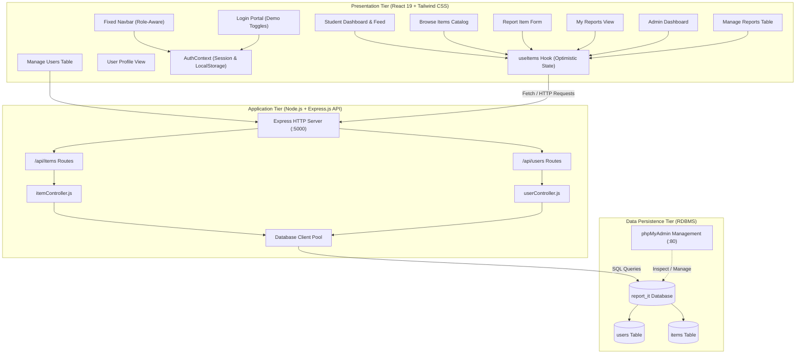

### 6.3 Application Workflow Diagram

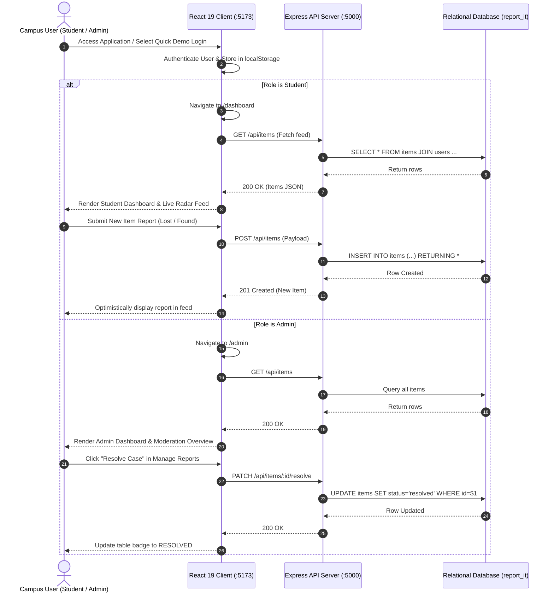

---

## 7. Database Design

### 7.1 Database Overview
- **Database Name:** `report_it`
- **Default Character Set:** `utf8mb4`
- **Default Collation:** `utf8mb4_general_ci`
- **Storage Engine:** `InnoDB` (supporting ACID compliance and foreign keys)

### 7.2 Relational Schema and Data Dictionary

#### Table 1: `users`
Stores registered campus accounts, student identification numbers, authentication credentials, and system roles.

| Column Name | Data Type | Nullable | Key / Constraint | Default Value | Description |
| :--- | :--- | :---: | :---: | :---: | :--- |
| `id` | `INT(11)` | No | `PRIMARY KEY`, `AUTO_INCREMENT` | *None* | Unique surrogate identifier for each user |
| `student_id` | `VARCHAR(30)` | No | `UNIQUE KEY` | *None* | Official institutional ID (e.g., `AJCE001`, `ADMIN01`) |
| `name` | `VARCHAR(120)` | No | *None* | *None* | Full registered name of the student or administrator |
| `password_hash`| `VARCHAR(255)` | No | *None* | `'unhashed_default'` | Cryptographic password hash string |
| `role` | `ENUM('student', 'admin')` | No | `CHECK (role IN ('student','admin'))` | `'student'` | Access control role determining portal authorization |
| `created_at` | `TIMESTAMP` | No | *None* | `CURRENT_TIMESTAMP` | System timestamp when the account was registered |

#### Table 2: `items`
Stores reports of lost and found belongings, location metadata, dates, categorization, and resolution lifecycle states.

| Column Name | Data Type | Nullable | Key / Constraint | Default Value | Description |
| :--- | :--- | :---: | :---: | :---: | :--- |
| `id` | `INT(11)` | No | `PRIMARY KEY`, `AUTO_INCREMENT` | *None* | Unique incident identifier for each report |
| `user_id` | `INT(11)` | No | `FOREIGN KEY` references `users(id)` | *None* | Foreign key linking report to author in `users` |
| `title` | `VARCHAR(150)` | No | *None* | *None* | Brief descriptive title of the misplaced item |
| `description` | `TEXT` | No | *None* | *None* | Identifying marks, stickers, color, model details |
| `location` | `VARCHAR(150)` | No | *None* | *None* | Specific campus location where lost or found |
| `item_date` | `DATE` | No | *None* | *None* | Calendar date when the incident occurred |
| `type` | `ENUM('lost', 'found')` | No | `CHECK (type IN ('lost','found'))` | *None* | Signal type indicating whether lost or found |
| `status` | `ENUM('active', 'resolved')`| No | `CHECK (status IN ('active','resolved'))`| `'active'` | Status flag indicating case disposition |
| `created_at` | `TIMESTAMP` | No | *None* | `CURRENT_TIMESTAMP` | System timestamp when the record was broadcasted |
| `resolved_at` | `TIMESTAMP` | Yes | *None* | `NULL` | Timestamp recorded when marked resolved |

### 7.3 Entity-Relationship (ER) Diagram

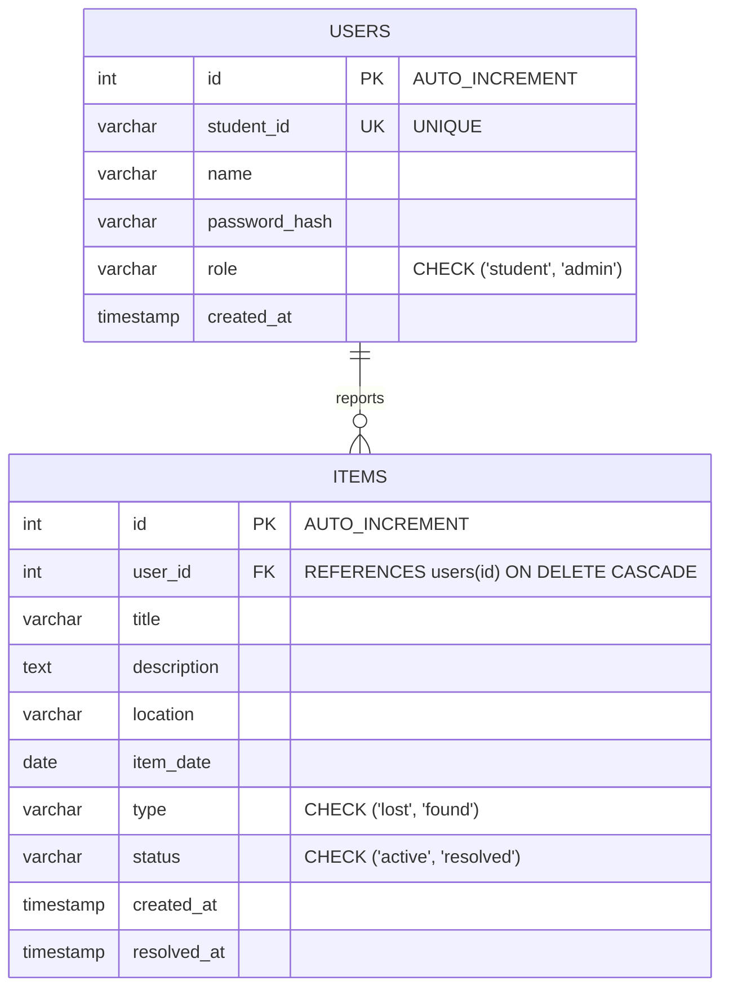

### 7.4 Keys, Integrity Constraints, and Relationships
1. **Entity Integrity:** Both tables declare an auto-incrementing integer `id` as `PRIMARY KEY`, ensuring row uniqueness.
2. **Domain Integrity:** The `type` and `status` columns are constrained to specific sets (`'lost'`, `'found'`) and (`'active'`, `'resolved'`), preventing invalid state entries.
3. **Referential Integrity:** The relationship `users.id` $\rightarrow$ `items.user_id` is governed by a foreign key constraint:
   ```sql
   CONSTRAINT fk_items_user FOREIGN KEY (user_id) REFERENCES users(id) ON DELETE CASCADE
   ```
   If a user account is deleted, all associated item reports are automatically deleted by the database engine, avoiding orphaned records.

### 7.5 Indexing Strategy and Query Optimization
The database defines B-Tree indexes targeting frequent query patterns:
1. `idx_items_type` on `items(type)`: Accelerates catalog filtering by signal type.
2. `idx_items_status` on `items(status)`: Optimizes retrieval of active versus resolved cases.
3. `idx_items_user_id` on `items(user_id)`: Accelerates ownership queries for the "My Reports" view.
4. `idx_items_created_at` on `items(created_at DESC)`: Speeds up sorting on chronological campus feeds.
5. `idx_items_status_type` on `items(status, type)`: A composite index tailored for multi-attribute dashboard queries.

### 7.6 Database Normalization Analysis (1NF to 3NF)
The `report_it` relational schema was engineered to adhere to third normal form (3NF):

- **First Normal Form (1NF):**
  - All attributes contain atomic, indivisible values (e.g., location strings, dates, titles).
  - No repeating groups or arrays exist; every row has a consistent set of columns.
  - A unique primary key (`id`) is defined for each table.

- **Second Normal Form (2NF):**
  - The schema meets 1NF.
  - In both tables, the primary key consists of a single column (`id`). As a result, no partial dependencies on composite keys can exist; all non-key attributes depend fully on the primary key.

- **Third Normal Form (3NF):**
  - The schema meets 2NF.
  - There are no transitive dependencies ($X \rightarrow Y \rightarrow Z$). Non-key attributes in `items` (`title`, `location`, `item_date`, `status`) depend solely on `id`. User details (such as `name` and `student_id`) are stored exclusively in `users` and accessed through the foreign key `user_id`, preventing data redundancy.

---

## 8. Syllabus Relevance: UI Design Lab & RDBMS Lab

### 8.1 User Interface Design Lab Mapping

| Syllabus Module / Concept | Relevant Project Implementation |
| :--- | :--- |
| **Module 1: UI Basics & Design Systems** | Created the "Daylight Archival" Neo-Brutalist design system in `tailwind.config.js` with off-white backgrounds (`#F3F4F1`), navy borders (`#111827`), hard-offset drop shadows, and high-contrast typography. |
| **Module 2: Introduction to React & JSX** | Built modular React components (`ItemCard.jsx`, `ReportForm.jsx`, `Navbar.jsx`) that combine templates with interaction logic using JSX syntax. |
| **Module 3: Modern React Hooks** | Used `useState` for form and modal states; `useEffect` for data synchronization; `useMemo` for statistics calculations; `useCallback` for API callbacks; and `useContext` for global session management. |
| **Module 4: Forms & Controlled Inputs** | `ReportForm.jsx` binds all input fields to React state, applies validation checks, disables buttons during transmission, and displays feedback alerts. |
| **Module 5: Routing & Navigation** | Implemented `react-router-dom` with a fixed, responsive navbar, mobile menu drawer, and route guards (`ProtectedRoute.jsx`, `DashboardRouter.jsx`). |
| **Module 6: Responsive Layouts** | Used CSS Grid and Flexbox with mobile-first Tailwind breakpoints (`sm:`, `md:`, `lg:`) to ensure responsiveness across devices. |
| **Module 7: Automated UI Testing** | Automated end-to-end user journeys and screenshot capture across pages using Playwright (`capture_screenshots.js`). |

### 8.2 RDBMS Lab Mapping

| Syllabus Module / Concept | Relevant Project Implementation |
| :--- | :--- |
| **Module 1: SQL Data Definition (DDL)** | Authored SQL definitions for tables, primary keys, auto-increment fields, unique keys, and timestamps (`schema.sql`, `database/schema_mysql.sql`). |
| **Module 2: Data Manipulation (DML)** | Executed parameterized SQL queries via Node.js Express controllers (`INSERT`, `SELECT`, `UPDATE`, `DELETE`). |
| **Module 3: Relational Constraints** | Enforced entity integrity (`PRIMARY KEY`), unique constraints on student IDs, domain checks (`ENUM`), and referential integrity (`ON DELETE CASCADE`). |
| **Module 4: Relational Joins & Aggregates**| Joined `items` with `users` (`JOIN users u ON i.user_id = u.id`) to fetch reporter information; computed dynamic counts using SQL aggregates and frontend reductions. |
| **Module 5: Query Optimization & Indexing**| Created single-column and composite B-tree indexes (`idx_items_status_type`, `idx_items_user_id`) to accelerate filter queries. |
| **Module 6: Normalization Theory** | Structured relational entities to satisfy 1NF, 2NF, and 3NF, eliminating attribute transitivities. |
| **Module 7: Database Administration** | Inspected table schemas, indexes, and table structures visually using phpMyAdmin. |

### 8.3 Identification of Non-Implemented Syllabus Concepts
To maintain documentation integrity, the following advanced laboratory syllabus topics were deliberately excluded:
- **Redux / Redux Toolkit:** State is managed via React Context and custom hooks; an external state container like Redux was not required for this project's scale.
- **PL/SQL Stored Procedures & Triggers:** Complex logic is currently handled in the Node.js application layer; database-resident triggers and stored procedures were not deployed.
- **Third-Party OAuth / SSO:** Authentication uses configured academic demo profiles and local persistence rather than external institutional identity providers.
- **Cloud Object Storage (AWS S3):** Photos and file uploads are handled structurally in database fields rather than streamed to cloud bucket stores.

---

## 9. Screenshots and Results

The screenshots below were captured from the running application on `http://localhost:5173` and the phpMyAdmin console on `http://localhost/phpmyadmin` using automated Playwright testing.

### 9.1 Application Interface Exhibits

#### Figure 1: System Access Portal with Quick Demo Access
The system login screen featuring the Neo-Brutalist card design, controlled email and password inputs, the primary Authorize button, and the **QUICK DEMO ACCESS** buttons for Student and Admin roles.

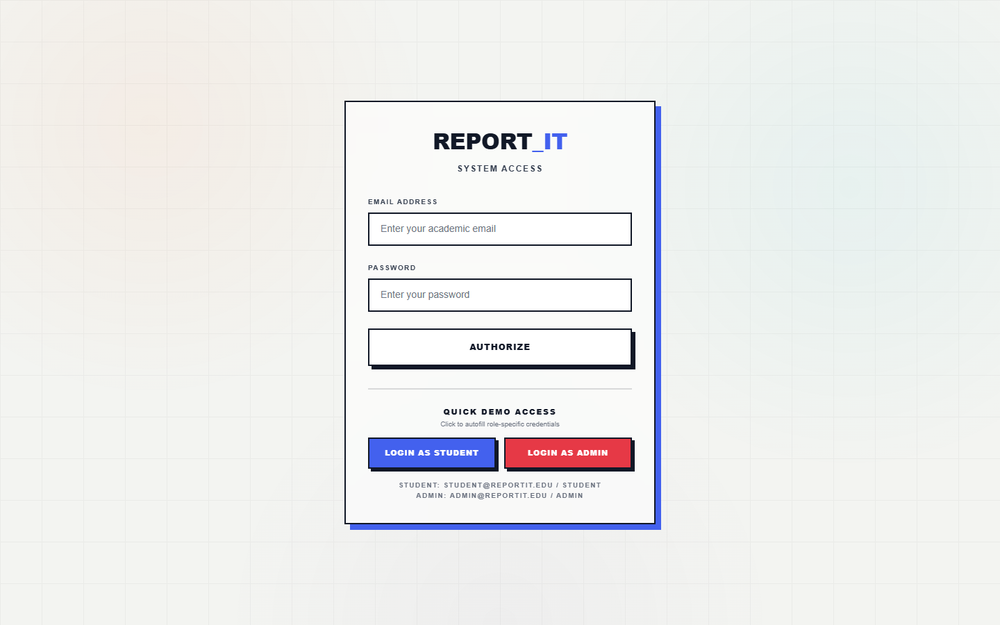

*Caption: Figure 1 – System Access Portal (`/login`) displaying Quick Demo Access buttons.*

---

#### Figure 2: Student Dashboard & Campus Radar Feed
The primary student interface featuring live summary cards (`LOST ITEMS`, `FOUND ITEMS`, `MY REPORTS`), quick report action buttons, recently reported item cards, and the live Campus Activity Feed.

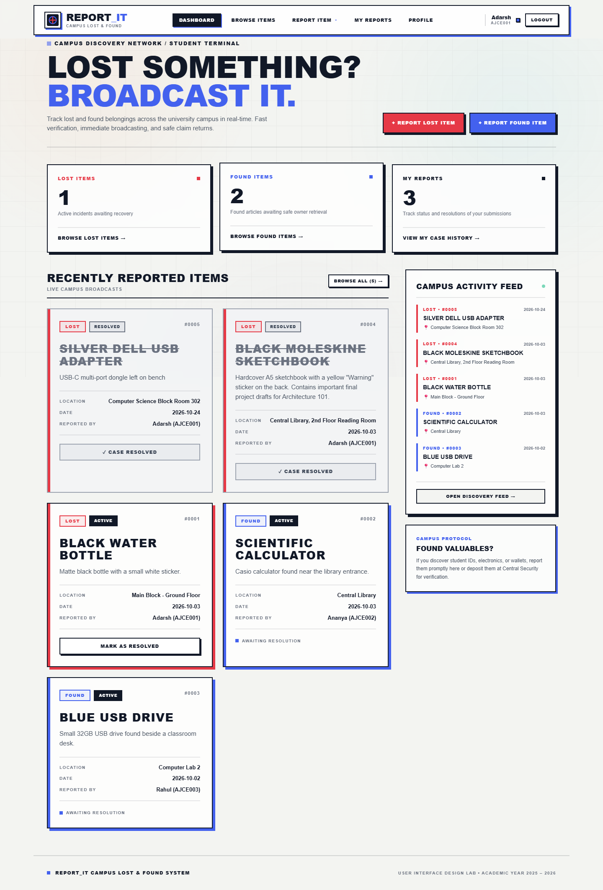

*Caption: Figure 2 – Student Dashboard (`/dashboard`) displaying metric cards, incident cards, and the live feed.*

---

#### Figure 3: Dedicated Item Reporting Interface
The reusable reporting form pre-selected for reporting a Lost Item, featuring signal type toggles, required-field indicators, location and date inputs, and submit actions.

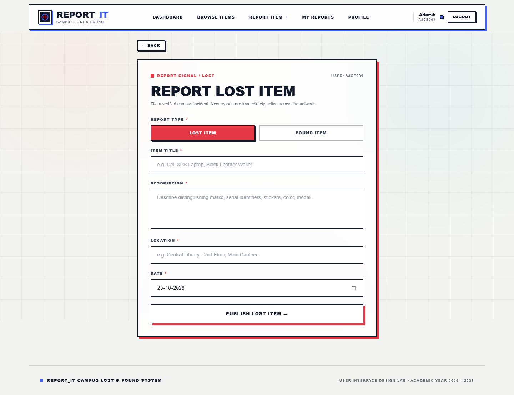

*Caption: Figure 3 – Item Reporting Portal (`/report?type=lost`) with controlled inputs and signal type toggling.*

---

#### Figure 4: Browse Campus Items Catalog
The discovery catalog featuring live keyword search, type buttons (`ALL`, `LOST`, `FOUND`), status dropdowns, sort selectors, and responsive item cards with clear status indicators.

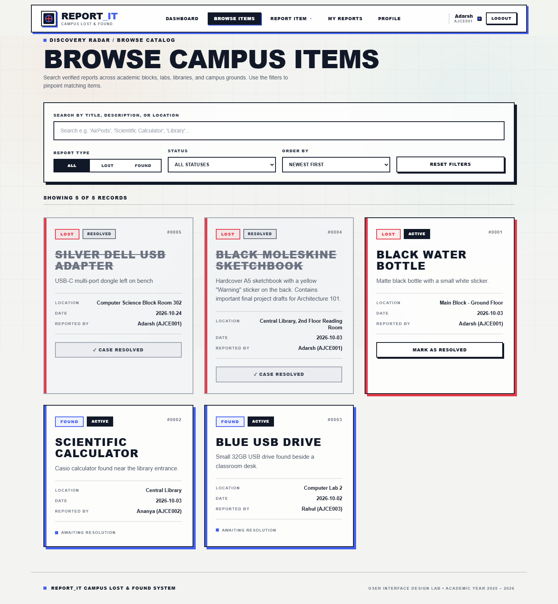

*Caption: Figure 4 – Browse Items Catalog (`/browse`) with search, filter controls, and item cards.*

---

#### Figure 5: Student Personal Case History (My Reports)
The personalized student case tracking page displaying records authored by the logged-in user, case status badges, and action triggers to mark active reports as resolved.

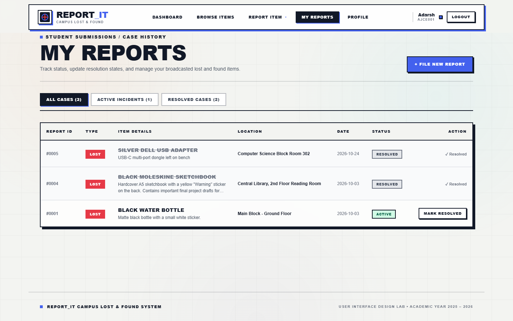

*Caption: Figure 5 – My Reports Page (`/my-reports`) showing authored cases and resolution actions.*

---

#### Figure 6: Student Credential & Profile View
The user profile interface showing the student's name, ID (`AJCE001`), email, enrollment status, campus clearance, and real activity metrics.

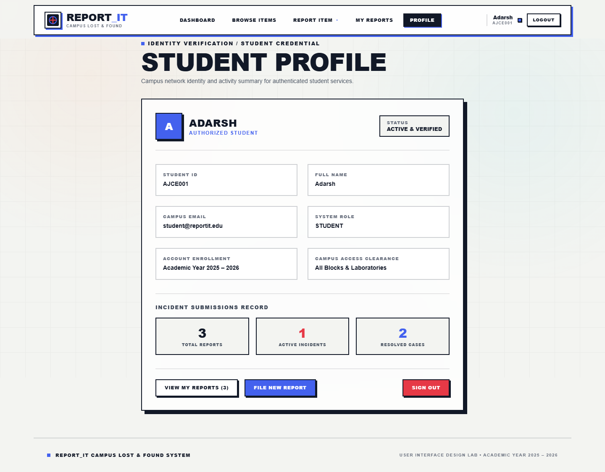

*Caption: Figure 6 – Student Profile View (`/profile`) displaying account details and submitted case metrics.*

---

#### Figure 7: Administrative Overview Dashboard
The administrative control center displaying summary metrics (`TOTAL REPORTS`, `PENDING REPORTS`, `RESOLVED CASES`), incident distribution progress bars, and the recent reports moderation queue.

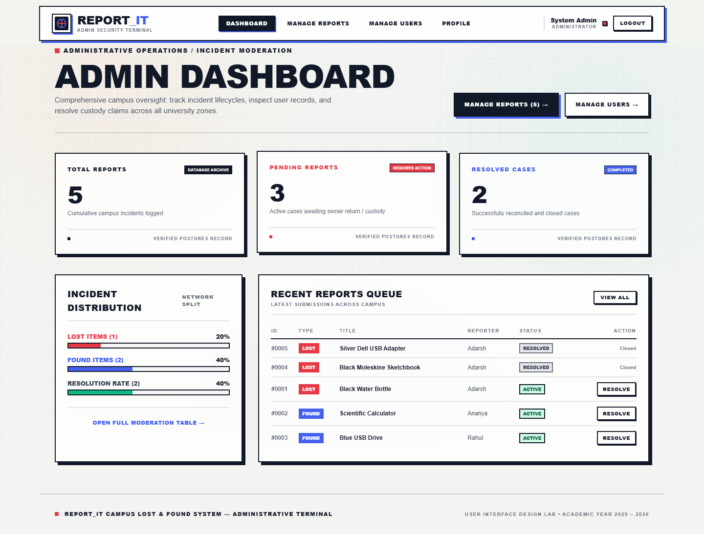

*Caption: Figure 7 – Administrative Overview Dashboard (`/admin`) displaying global statistics and moderation queues.*

---

#### Figure 8: Administrative Report Moderation Table
The comprehensive moderation interface in the admin portal, featuring multi-column tables, inline view modals, force-resolve actions, and delete options with confirmation dialogs.

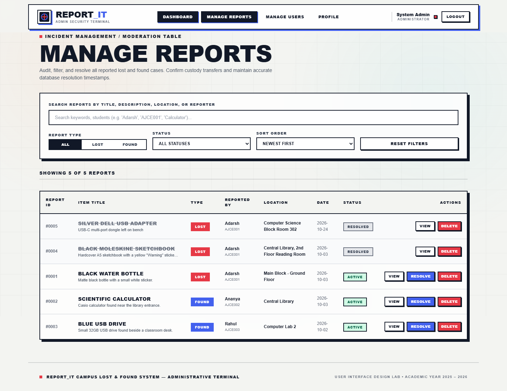

*Caption: Figure 8 – Manage Reports Interface (`/admin/reports`) with moderation controls.*

---

#### Figure 9: Administrative User Directory Table
The user management interface displaying registered accounts (`users` table), student IDs, roles, and creation dates, while keeping password hashes concealed.

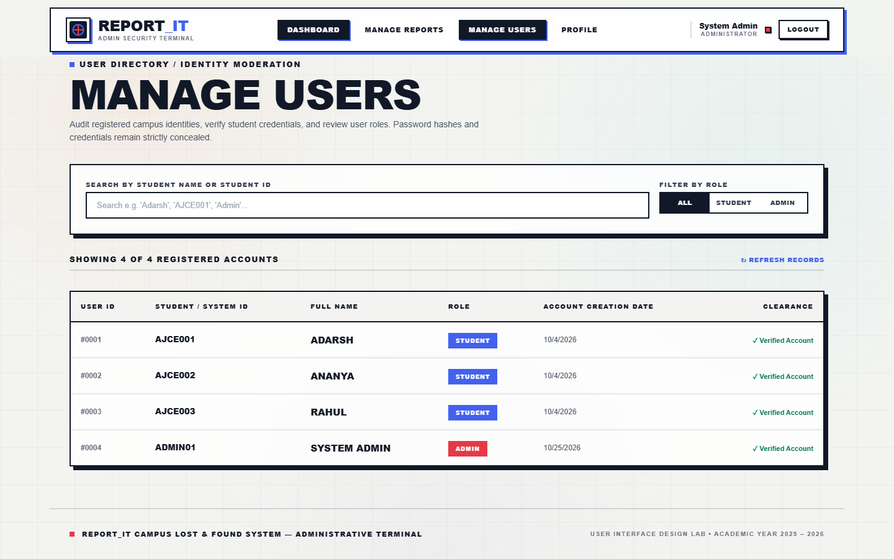

*Caption: Figure 9 – Manage Users Interface (`/admin/users`) with account verification status.*

---

#### Figure 10: Administrator Credential & Security Profile View
The profile interface adapted for administrators, showing security clearance levels, system ID (`ADMIN01`), and global campus incident metrics.

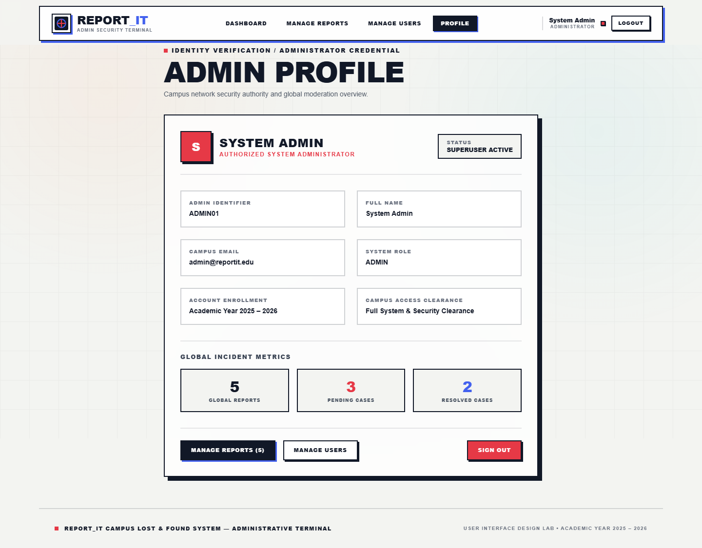

*Caption: Figure 10 – Administrator Security Profile (`/profile`) displaying clearance status and system metrics.*

---

### 9.2 Database and phpMyAdmin Schema Exhibits

#### Figure 11: phpMyAdmin Database Schema Overview
The structural overview of the `report_it` database in phpMyAdmin, displaying table listings (`items`, `users`), InnoDB storage engines, row counts, collation, and storage sizes.

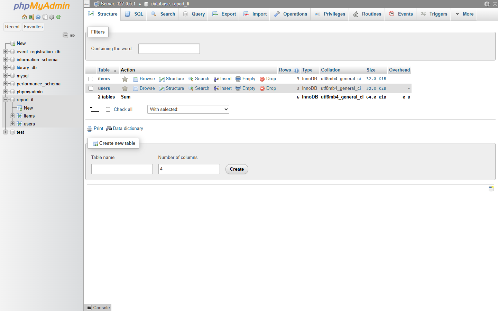

*Caption: Figure 11 – phpMyAdmin Database Overview showing storage engine, row counts, and table footprints.*

---

#### Figure 12: phpMyAdmin `users` Table Structure
Detailed schema view of the `users` table in phpMyAdmin, displaying columns, data types, auto-increment primary key `id`, and the unique constraint on `student_id`.

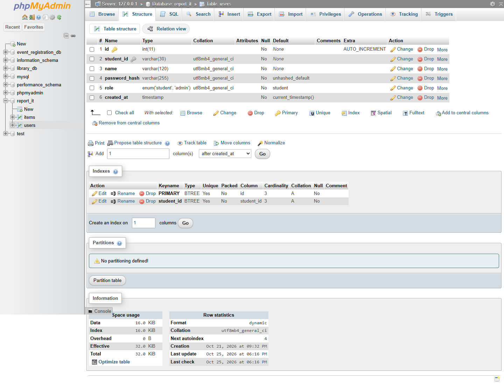

*Caption: Figure 12 – Structural definition and indexes of the `users` table in phpMyAdmin.*

---

#### Figure 13: phpMyAdmin `items` Table Structure
Detailed schema view of the `items` table in phpMyAdmin, displaying columns, domain constraints, auto-increment primary key `id`, foreign key index `fk_items_user`, and status/type columns.

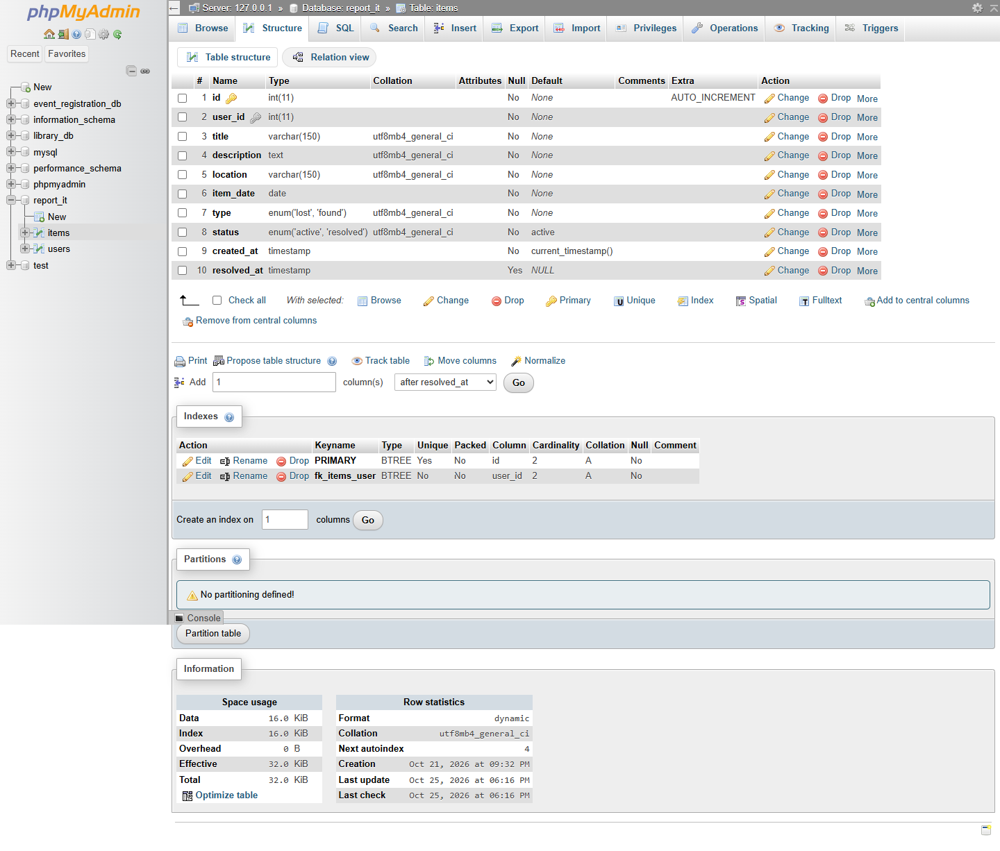

*Caption: Figure 13 – Structural definition, foreign key index, and constraints of the `items` table in phpMyAdmin.*

---

## 10. Advantages

1. **Structured Data Capture:** Replaces ambiguous social media text notices with normalized database records containing explicit locations, dates, and item metadata.
2. **Clear Visual Hierarchy:** The Neo-Brutalist design utilizes high-contrast borders and color-coded signal badges (`#E63946` for Lost, `#4361EE` for Found), improving scan speed.
3. **Role-Based Workflows:** Separates student reporting views from administrative moderation dashboards, reducing clutter for general users while giving moderators full administrative tools.
4. **Relational Integrity:** Implements foreign key constraints with cascading deletes and domain checks, preventing orphaned records and ensuring database consistency.
5. **Fast Client Responsiveness:** Utilizes client-side routing, React state management, and optimistic UI updates for quick interactions.
6. **Query Optimization:** Employs composite and single-column B-tree indexes, ensuring fast query performance as incident volumes grow.

---

## 11. Limitations

1. **Non-Persistent Authentication:** Authentication uses configured institutional user profiles and browser `localStorage` rather than production JSON Web Tokens (JWT) or server-side sessions.
2. **Plaintext Password Placeholders:** In this local academic demonstration, passwords are not hashed using `bcrypt` on the client side, relying instead on database default values.
3. **No Image Upload Pipeline:** While the database models textual metadata cleanly, binary photo uploads (e.g., via AWS S3 or Cloudinary) are not yet integrated into the reporting pipeline.
4. **Absence of Push Notifications:** The application does not currently dispatch automated emails or SMS alerts when a matching item is reported.

---

## 12. Future Enhancements

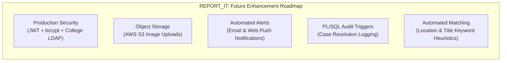

1. **Production Authentication:** Integrate bcrypt password hashing and HTTP-only JWT cookies, with optional institutional LDAP/SSO integration.
2. **Media Attachments:** Connect the reporting form to an S3-compatible object storage service, allowing users to attach photographs of lost or found items.
3. **Automated Notification Triggers:** Implement Web Push API and background email alerts to notify students when an item matching their description is registered.
4. **PL/SQL Audit Triggers:** Implement database triggers (`AFTER UPDATE`, `AFTER DELETE`) to log administrative actions to an audit history table.
5. **Algorithmic Matching:** Develop a heuristic matching algorithm that pairs lost items with found items based on location proximity, date, and keyword similarity.

---

## 13. Conclusion

The **REPORT_IT: Campus Lost and Found Management System** demonstrates the integration of human-centered frontend engineering with structured relational database architecture.

From the perspective of the **User Interface Design Laboratory**, the project showcases modern web application design principles:
- An accessible "Daylight Archival" Neo-Brutalist design system.
- Component-driven UI architecture built using React 19 and Tailwind CSS.
- Responsive layouts built with CSS Grid and Flexbox.
- Declarative client-side routing and protected paths.
- Controlled input forms with validation and user feedback.

From the perspective of the **RDBMS Laboratory**, the project applies core database engineering principles:
- A normalized (3NF) relational database schema.
- Entity, referential, and domain integrity enforced through primary keys, foreign keys, and column constraints.
- Optimized query execution via single and composite B-tree indexes.
- RESTful database integration through Node.js Express controllers.
- Schema verification and table inspection through phpMyAdmin.

By combining both disciplines into a functional application, REPORT_IT provides a practical solution to a common campus challenge while fulfilling the learning objectives of both curricula.

---

## 14. Repository and References

### 14.1 Codebase & Academic Repository
- **Project Name:** REPORT_IT Campus Lost and Found Management System
- **Lead Developer:** Adarsh (Student ID: AJCE001)
- **Institution:** Department of Computer Science and Engineering, Amal Jyothi College of Engineering
- **Academic Year:** 2025 – 2026

### 14.2 Official Documentation & References
1. **React 19 Documentation:** *React – A JavaScript Library for Building User Interfaces.* [https://react.dev/](https://react.dev/)
2. **Tailwind CSS Documentation:** *Tailwind CSS Utility-First Framework Documentation.* [https://tailwindcss.com/docs](https://tailwindcss.com/docs)
3. **React Router Documentation:** *Declarative Routing for React Web Applications.* [https://reactrouter.com/](https://reactrouter.com/)
4. **MySQL 8.0 Reference Manual:** *Data Definition, Keys, and Indexes.* [https://dev.mysql.com/doc/](https://dev.mysql.com/doc/)
5. **PostgreSQL 16 Documentation:** *The World's Most Advanced Open Source Relational Database.* [https://www.postgresql.org/docs/](https://www.postgresql.org/docs/)
6. **Express.js API Reference:** *Fast, Unopinionated, Minimalist Web Framework for Node.js.* [https://expressjs.com/](https://expressjs.com/)
7. **Playwright Automation Framework:** *Fast and Reliable End-to-End Testing for Modern Web Apps.* [https://playwright.dev/](https://playwright.dev/)
8. **W3C Web Content Accessibility Guidelines (WCAG) 2.1:** *Contrast Minimum (Level AA) Technical Specification.* [https://www.w3.org/WAI/WCAG21/quickref/](https://www.w3.org/WAI/WCAG21/quickref/)
